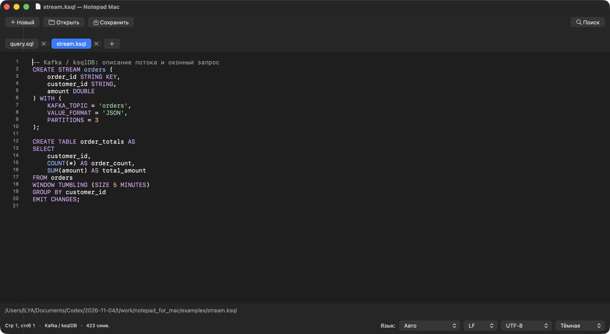

<p align="center">
  
</p>
<h1 align="center">Notepad Mac</h1>
<p align="center">
  <a href="#install">Установка</a> · <a href="#features">Возможности</a> · <a href="#updates">Обновления</a> · <a href="#formats">Форматы</a> · <a href="#support">Поддержать</a>
</p>


<p align="center">
  <a href="https://github.com/starscream001/notepad_for_mac/releases/latest"></a>
  <a href="https://github.com/starscream001/notepad_for_mac/actions/workflows/build.yml"></a>
  
  <a href="docs/STATS.md"></a>
  <a href="LICENSE"></a>
</p>
<p align="center">
  <a href="https://github.com/starscream001/notepad_for_mac/releases/latest/download/Notepad-Mac-universal.zip"></a>
  <a href="https://github.com/starscream001/notepad_for_mac/releases"></a>
</p>
<p align="center"><strong>Intel + Apple Silicon</strong> · Один архив · Без входа в GitHub · Бесплатно</p>



<a id="features"></a>

## Рабочая вкладка — без лишнего

<table>
<tr>
<td width="50%" valign="top">
<h3>Текст и код</h3>
<p>Вкладки сверху, номера строк, автоотступы, перенос строк и привычные сочетания клавиш macOS. Открывайте несколько файлов и переключайтесь между ними.</p>
</td>
<td width="50%" valign="top">
<h3>SQL и Kafka / ksqlDB</h3>
<p>Ключевые слова, строки, функции, параметры и комментарии. Язык определяется по расширению; для новой вкладки или <code>.txt</code> его можно выбрать вручную.</p>
</td>
</tr>
<tr>
<td width="50%" valign="top">
<h3>Продолжить с того же места</h3>
<p>После перезапуска восстанавливаются вкладки, несохранённый текст, позиция курсора и выбранная подсветка. Светлая, тёмная и системная темы.</p>
</td>
<td width="50%" valign="top">
<h3>Найти и изменить</h3>
<p>Поиск и замена с регулярными выражениями, учёт регистра и отмена правок. UTF-8 / UTF-16, окончания строк LF / CRLF / CR.</p>
</td>
</tr>
</table>

Запись файлов атомарная. Перед перезаписью документа, изменённого другой программой, редактор предупредит. Текст документов остаётся на вашем Mac.

<a id="install"></a>
<a id="установить-на-mac"></a>

## От скачивания до первой вкладки


1. **[Скачайте Notepad-Mac-universal.zip](https://github.com/starscream001/notepad_for_mac/releases/latest/download/Notepad-Mac-universal.zip)**.
2. Дважды нажмите на архив в **«Загрузках»**.
3. Перетащите **Notepad Mac.app** в **«Программы»** и запустите.

Нужна **macOS 13 Ventura или новее**. Один файл подходит для **Intel и Apple Silicon**. Xcode и самостоятельная компиляция для запуска не требуются.

<details>
<summary><strong>macOS блокирует первый запуск?</strong></summary>

Приложение пока имеет локальную подпись и не заверено Apple. После первой попытки запуска откройте ** → Системные настройки → Конфиденциальность и безопасность**. Найдите сообщение о Notepad Mac и нажмите **«Всё равно открыть»**, затем подтвердите запуск. Название кнопки зависит от версии macOS.

</details>

<details>
<summary><strong>Какой файл скачивать из Releases?</strong></summary>

В [последнем релизе](https://github.com/starscream001/notepad_for_mac/releases/latest), в разделе **Assets**, выберите **Notepad-Mac-universal.zip** — это готовое приложение. Файл `.sha256` нужен для дополнительной проверки архива. **Source code (zip / tar.gz)** содержит исходники для разработчиков.

Finder может показывать имя приложения без расширения `.app`.

</details>

<a id="updates"></a>

## Новая версия — прямо в приложении

<table>
<tr>
<td width="52%" valign="top">
<h3>Проверять удобно. Устанавливать спокойно.</h3>
<p>Меню <strong>Notepad Mac → Проверить обновления…</strong> ищет стабильный выпуск на GitHub. Автопроверка работает при запуске, возвращении в редактор и по расписанию при наличии сети.</p>
<p><strong>6 часов · сутки · неделя</strong><br>По умолчанию — раз в сутки. Автопроверку можно отключить; ручная проверка остаётся доступной.</p>
<p>Загрузка показывает прогресс и допускает отмену. Перед заменой проверяются архив и пакет, сохраняется сессия. Предыдущая версия остаётся до подтверждения запуска новой.</p>
<p><a href="docs/UPDATES.md">Подробнее о процессе обновления →</a></p>
</td>
<td width="48%" valign="top">

</td>
</tr>
</table>

**Первый переход с 0.1 / 0.2 на 0.3 — вручную:** скачайте ZIP и замените приложение через Finder после выхода через **⌘Q**. Начиная с 0.3, последующие версии можно устанавливать из редактора. Сессии прежних версий совместимы.

[Что нового в 0.4.0](https://github.com/starscream001/notepad_for_mac/releases/tag/v0.4.0) · [История изменений](CHANGELOG.md) · [Все релизы](https://github.com/starscream001/notepad_for_mac/releases)

<a id="formats"></a>

## Предпросмотр Markdown и HTML

Нажмите **«Просмотр»** или **⌥⌘P**: слева — исходный текст, справа — результат. Панели можно растягивать разделителем. Просмотр обновляется при вводе и работает без интернета. Поддерживаются Markdown (включая таблицы и блоки кода) и HTML со встроенным CSS. Для новой вкладки выберите нужный язык внизу окна.

Скрипты, формы, внешние ресурсы и локальные файлы из HTML не загружаются. Ссылки открываются в браузере. Предел предпросмотра — 2 МБ.

## Файлы, с которыми вы работаете

Открывайте обычные текстовые файлы с любыми расширениями: `.txt`, `.log`, `.csv`, `.ini` и другие. Подсветка предусмотрена для:

| Язык / формат | Расширения |
|---|---|
| **SQL** | `.sql`, `.psql`, `.pgsql`, `.mysql`, `.ddl`, `.dml` |
| **Kafka / ksqlDB** | `.ksql`, `.ksqldb` |
| Swift | `.swift` |
| JavaScript / TypeScript | `.js`, `.jsx`, `.mjs`, `.cjs`, `.ts`, `.tsx` |
| Python | `.py`, `.pyw` |
| JSON / YAML | `.json`, `.yaml`, `.yml` |
| HTML / XML / SVG | `.html`, `.htm`, `.xml`, `.svg` |
| CSS / SCSS | `.css`, `.scss` |
| C / C++ / Objective-C | `.c`, `.h`, `.cpp`, `.hpp`, `.cc`, `.m`, `.mm` |
| Markdown / Shell | `.md`, `.markdown`, `.sh`, `.bash`, `.zsh` |

**«Язык» внизу окна** позволяет включить нужную подсветку для любого файла. **«Авто»** определяет её по расширению. Примеры: [SQL](examples/query.sql) и [ksqlDB](examples/stream.ksql).

Поддержка запросов относится к редактированию и подсветке текста. Кодировки: **UTF-8, UTF-8 BOM, UTF-16 LE/BE с BOM**. Word, PDF, Excel и другие бинарные форматы, а также Windows-1251 пока не поддерживаются.

<details>
<summary><strong>Горячие клавиши</strong></summary>

| Действие | Клавиши |
|---|---|
| Новая вкладка / открыть | ⌘N / ⌘O |
| Сохранить / сохранить как | ⌘S / ⇧⌘S |
| Закрыть вкладку | ⌘W |
| Найти / заменить | ⌘F |
| Следующее / предыдущее совпадение | ⌘G / ⇧⌘G |
| Перейти к строке | ⌘L |
| Следующая / предыдущая вкладка | ⇧⌘] / ⇧⌘[ |
| Перенос строк | ⌥⌘W |
| Размер шрифта | ⌘= / ⌘− |

</details>

<details>
<summary><strong>Восстановление сессии и ограничения</strong></summary>

При выходе через **⌘Q** сессия сохраняется локально. При закрытии отдельной изменённой вкладки можно сохранить файл, отменить закрытие или удалить изменения этой вкладки.

Файл сессии: `~/Library/Application Support/NotepadMac/session.json`. Он содержит полный текст открытых документов и доступен текущему пользователю (`0600`). Важные документы сохраняйте в обычные файлы: восстановление сессии не заменяет резервные копии.

Предел при открытии — **20 МБ**. Подсветка отключается для текстов от 500 000 UTF-16 единиц. Смешанные окончания строк нормализуются при сохранении. Подсветка — облегчённый лексический разбор; пока нет Windows DLL-плагинов, макросов, сворачивания кода, разделения редактора и поиска по папке.

</details>

<a id="support"></a>

## Сделано Ильёй. Развивается с вашей поддержкой.

Разработчик — **Илья ([starscream001](https://github.com/starscream001))**. Notepad Mac — бесплатный проект с открытым исходным кодом. Поддержка добровольная; все функции доступны каждому.

<table>
<tr>
<td width="50%" valign="top">
<h3>Поддержать через СБП</h3>
<p><strong>+7 (963) 243-31-00</strong><br>Ozon Банк</p>
<p>Сумму вы выбираете самостоятельно. В приложении откройте <strong>«Поддержать разработчика…»</strong>, чтобы скопировать номер.</p>
<p><a href="docs/SUPPORT.md">Все способы поддержки →</a></p>
</td>
<td width="50%" valign="top">
<h3>Помочь проекту</h3>
<p>Поставьте звезду репозиторию, расскажите о редакторе, сообщите об ошибке или предложите улучшение.</p>
<p><a href="https://github.com/starscream001/notepad_for_mac/issues">Обсудить идею или ошибку →</a></p>
</td>
</tr>
</table>

**MIT.** Можно использовать, изменять и распространять программу, в том числе коммерчески, сохраняя уведомление об авторстве и текст лицензии. Программа предоставляется «как есть», без гарантий.

[Полная лицензия](LICENSE) · [Пояснение на русском](docs/LICENSING.md) · [Как считаются скачивания](docs/STATS.md)

<details>
<summary><strong>Разработчикам: сборка, проверки и выпуск версии</strong></summary>

Нужны macOS 13+, Swift 5.9+ и Apple Command Line Tools либо Xcode. Внешних пакетов нет.

```sh
git clone https://github.com/starscream001/notepad_for_mac.git
cd notepad_for_mac
swift run CoreChecks
UNIVERSAL=1 ./scripts/build.sh
open "dist/Notepad Mac.app"
```

Для сборки только под текущий Mac выполните `./scripts/build.sh`. Для разработки — `swift run NotepadMac`. Проверка настоящей загрузки с GitHub: `swift run CoreChecks --network`.

В `dist/` создаются приложение, ZIP и SHA-256. Установщик `NotepadUpdater` компилируется отдельно и входит в `.app`. Скрипт подписывает приложение ad-hoc и проверяет подпись.

**22 проверки ядра** покрывают текст, кодировки, поиск, сессии, SQL / ksqlDB, версии и расписание обновлений, SHA-256, пути ZIP и откат замены приложения. Полный сценарий замены 0.2 → 0.3 с перезапуском и восстановлением несохранённого текста проверен на Apple Silicon. Intel собирается перекрёстно; запуск на реальном Intel Mac нужно проверить отдельно.

### Версии на GitHub

Рабочая ветка — **`main`**. Готовые версии закрепляются тегами **`v0.1.0`**, **`v0.2.0`**, **`v0.3.0`** и публикуются в **Releases**. Отдельные ветки для версий не требуются.

Номер хранится в [VERSION](VERSION), описание — в [docs/releases](docs/releases), краткая история — в [CHANGELOG.md](CHANGELOG.md). Для следующего релиза обновите номер, добавьте `docs/releases/v<версия>.md`, запись в историю и отправьте изменения в `main`.

GitHub Actions запускает проверки и universal-сборку. Новый релиз публикуется из черновика после добавления ZIP и контрольной суммы. Опубликованные номерные версии не перезаписываются. Кнопка скачивания использует стандартный `releases/latest/download/…`.

Промежуточные сборки: **Actions → Artifacts → Notepad-Mac-universal**. Они хранятся 30 дней и требуют входа в GitHub.

| Путь | Содержимое |
|---|---|
| `Sources/NotepadCore` | Текст, поиск, сессия, SQL / ksqlDB и ядро обновлений |
| `Sources/NotepadMac` | Нативный интерфейс AppKit / TextKit |
| `Sources/NotepadUpdater` | Установка, резервная копия и откат |
| `Tests/NotepadCoreTests` | Проверки ядра |
| `Resources` | Иконка, метаданные и реквизиты поддержки |
| `docs` | Документация, история версий и иллюстрации |

Для отдельной тестовой сессии: `NOTEPAD_SESSION_DIR=/путь/к/папке`.

</details>

---

<p align="center">Notepad Mac · macOS 13+ · Intel + Apple Silicon · <a href="LICENSE">MIT</a></p>
<p align="center">Независимый проект, вдохновлённый Notepad++. Интерфейс и иконка — собственные.</p>
