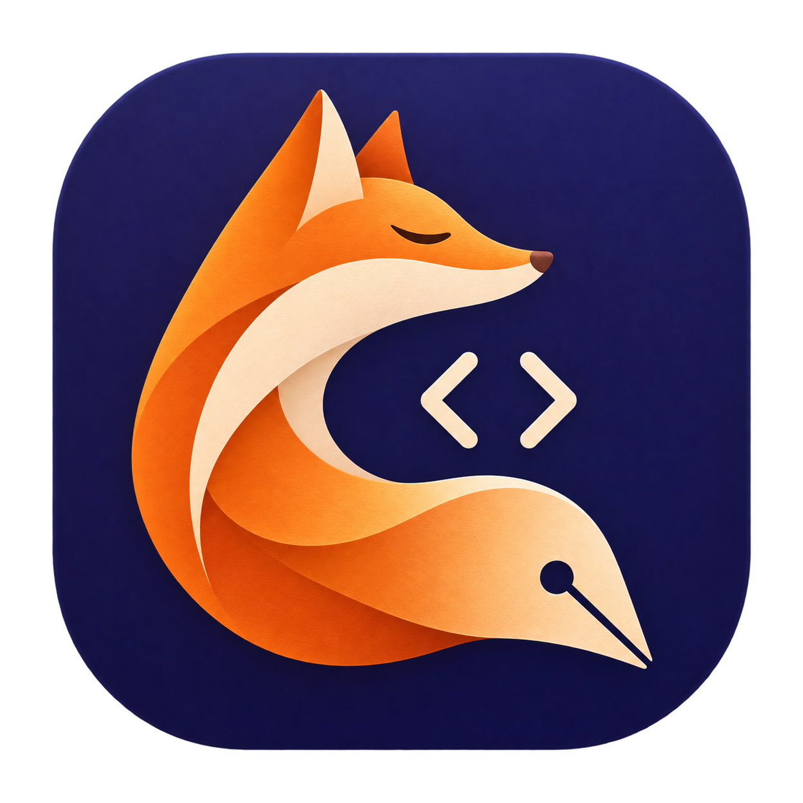

# Notepad Mac 0.2.0

## Что нового

- **SQL:** автоматическая подсветка `.sql`, `.psql`, `.pgsql`, `.mysql`, `.ddl` и `.dml`.
- **Kafka / ksqlDB:** подсветка `.ksql` и `.ksqldb`, включая `CREATE STREAM`, `KAFKA_TOPIC`, `WINDOW TUMBLING` и `EMIT CHANGES`.
- **Выбор языка:** меню «Язык» внизу окна позволяет включить SQL или Kafka / ksqlDB для новой вкладки, `.txt` и других файлов. «Авто» определяет язык по расширению. Выбор восстанавливается вместе с вкладкой.
- **Точная подсветка запросов:** строки с экранированными кавычками, кавыченные идентификаторы, числа, функции, параметры `:name`, `$1`, `?`, комментарии `--` и `/* … */`, PostgreSQL dollar-quoted строки. Маркеры комментариев внутри строк не меняют их цвет.
- **Новая иконка:** собственный лис-перо с символами кода на тёмном индиго-фоне.
- **Примеры:** `examples/query.sql` и `examples/stream.ksql` в репозитории.

Поддержка SQL и Kafka / ksqlDB относится к редактированию и подсветке текста запросов.

## Скачать и установить

Скачайте **Notepad-Mac-universal.zip**, распакуйте и перенесите **Notepad Mac.app** в «Программы». Один архив подходит для Apple Silicon и Intel, macOS 13+.

При блокировке первого запуска: «Системные настройки → Конфиденциальность и безопасность → Всё равно открыть». Подробная инструкция: https://github.com/starscream001/notepad_for_mac#установить-на-mac

Для обновления завершите приложение через ⌘Q и замените его в «Программах». Сессия версии 0.1 совместима с 0.2.

## Проверка

12 проверок ядра: кодировки и окончания строк, поиск и замена, Unicode, восстановление сессии, определение языка, разбор SQL / ksqlDB и совместимость сессий. Universal-сборка, проверка подписи и упаковка ZIP выполняются автоматически в GitHub Actions. Запуск проверяется на Apple Silicon; Intel собирается перекрёстно.
