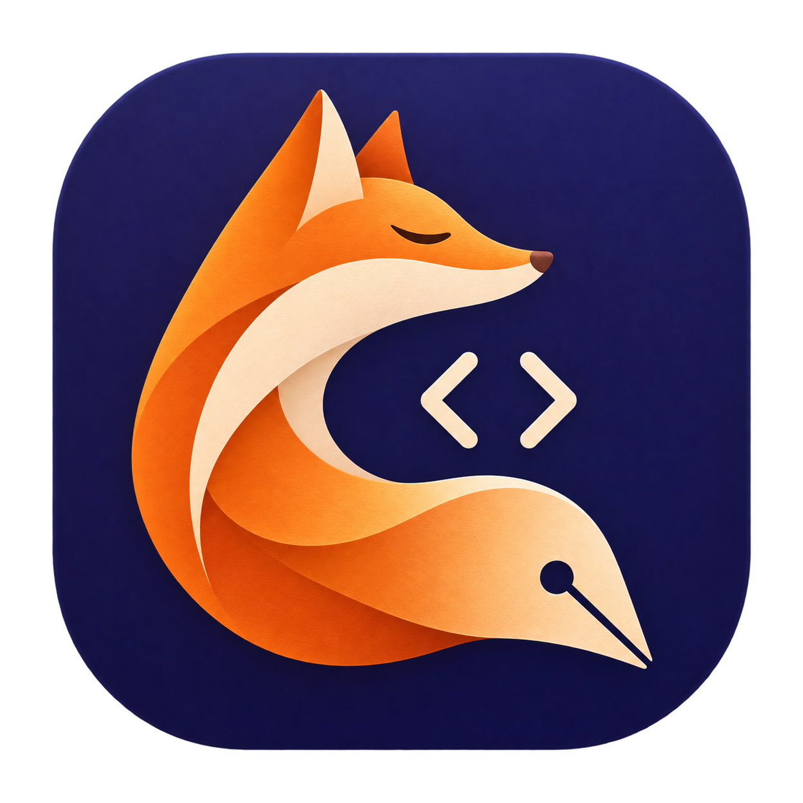

## Что нового

- **Обновления внутри приложения:** ручная проверка через меню, автоматическая при запуске и по расписанию при наличии сети.
- **Периодичность:** каждые 6 часов, раз в сутки (по умолчанию), раз в неделю или отключение автоматической проверки.
- **Скачивание и установка:** прогресс и отмена загрузки, сверка SHA-256 с GitHub, проверка пакета и перезапуск с восстановлением сессии.
- **Восстановление при ошибке:** предыдущая копия сохраняется до подтверждения запуска новой версии; при ошибке замены или запуска выполняется откат.
- **О программе:** разработчик — Илья (starscream001), кликабельные ссылки на профиль GitHub и репозиторий и информация о MIT.
- **Поддержка разработчика:** отдельное окно с реквизитами СБП (Ozon Банк), копированием номера и ссылкой на GitHub.
- **Лицензия:** стандартная MIT и русскоязычное пояснение об авторстве, правах пользователя и добровольной поддержке.

## Установка и переход с 0.2

Скачайте **Notepad-Mac-universal.zip**, распакуйте и замените **Notepad Mac.app** в «Программах». Один архив — для Intel и Apple Silicon, macOS 13+.

**Первый переход с 0.1 / 0.2 на 0.3 выполняется вручную.** Начиная с 0.3, проверка и установка последующих версий доступны в самом приложении. Перед заменой сохраните важные файлы и завершите редактор через ⌘Q. Сессия совместима с предыдущими версиями.

При первом запуске возможен диалог macOS о разработчике: «Системные настройки → Конфиденциальность и безопасность → Всё равно открыть».

[Как устроены обновления](https://github.com/starscream001/notepad_for_mac/blob/v0.3.0/docs/UPDATES.md) · [Поддержать разработчика](https://github.com/starscream001/notepad_for_mac/blob/v0.3.0/docs/SUPPORT.md) · [Лицензия](https://github.com/starscream001/notepad_for_mac/blob/v0.3.0/docs/LICENSING.md)
