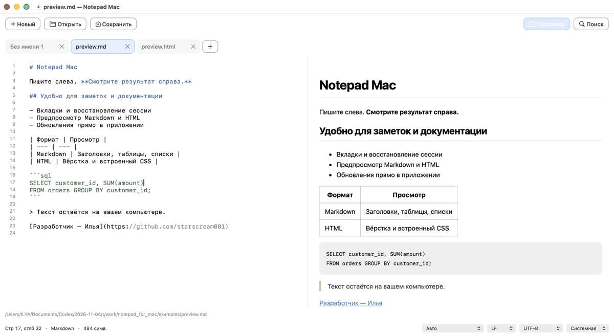

# Notepad Mac 0.5.0 · Аккуратный интерфейс

- Скруглённые кнопки с единым размером, отступами и состояниями нажатия.
- Цельные вкладки: крестик внутри вкладки, выровнен по центру; длинные названия сокращаются, полный путь доступен в подсказке.
- Выбранная вкладка выделяется мягким акцентом без яркой заливки текста.
- Отдельная область номеров строк вместо системной линейки: устранена лишняя вертикальная линия, рисование ограничено редактором.
- Компактная строка состояния и выбора языка/кодировки, сокращение длинных путей.
- README в едином стиле, GIF реального предпросмотра и история выпусков.

Сохраняет возможности 0.4: Markdown и HTML справа, SQL / ksqlDB, восстановление вкладок и обновления внутри приложения.

## Обновление

Из 0.3 / 0.4: **Notepad Mac → Проверить обновления…**. Или скачайте **Notepad-Mac-universal.zip**, завершите приложение и замените его в «Программах». macOS 13+, Intel и Apple Silicon.

Разработчик — [Илья (starscream001)](https://github.com/starscream001). Лицензия MIT.
